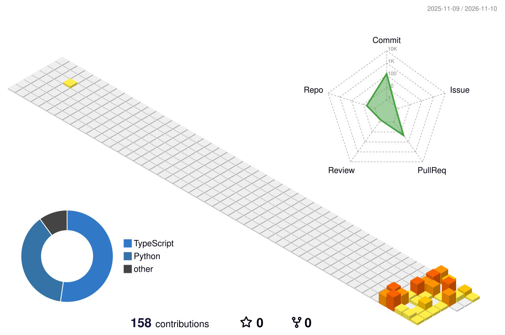

  

  
  
  
  

 

<picture>
  <source media="(prefers-color-scheme: dark)" srcset="https://readme-typing-svg.demolab.com?font=Playfair+Display&weight=700&size=28&duration=1&pause=100000&color=C7D2FE&vCenter=true&repeat=false&width=320&height=44&lines=About+me"/>
  
</picture>

<table>
<tr>
<td width="60%" valign="top">

I spent my early career in **healthcare**, where I saw first-hand how much damage a single leaked record can do. That's what pulled me into **cybersecurity**.

Today I build **detection tools** that read logs, spot attacks and map them to **MITRE ATT&CK**, and I build things for the web with **Next.js**.

- 🛡️ &nbsp;Learning: threat detection, log analysis, incident response
- 🐧 &nbsp;Living in: Linux, Bash, Python
- 🌱 &nbsp;Next up: SIEM pipelines & cloud security
- 💬 &nbsp;Ask me about: SSH attacks, phishing analysis, healthcare data

</td>
<td width="40%" align="center" valign="middle">

</td>
</tr>
</table>

<picture>
  <source media="(prefers-color-scheme: dark)" srcset="https://readme-typing-svg.demolab.com?font=Playfair+Display&weight=700&size=28&duration=1&pause=100000&color=C7D2FE&vCenter=true&repeat=false&width=320&height=44&lines=My+toolbox"/>
  
</picture>

  

<picture>
  <source media="(prefers-color-scheme: dark)" srcset="https://readme-typing-svg.demolab.com?font=Playfair+Display&weight=700&size=28&duration=1&pause=100000&color=C7D2FE&vCenter=true&repeat=false&width=320&height=44&lines=Things+I've+built"/>
  
</picture>

| | Project | What it does |
|:-:|---|---|
| 🔐 | [**ssh-bruteforce-detector**](https://github.com/aalsheikh1/ssh-bruteforce-detector) | Detects SSH brute-force, password-spraying and compromise attempts in Linux auth logs, with live monitoring, optional `ufw` blocking and ATT&CK mapping (T1110, T1078). |
| 🎣 | [**phishing-email-analyzer**](https://github.com/aalsheikh1/phishing-email-analyzer) | Opens suspicious `.eml` files and scores them for phishing indicators. |
| 🌐 | [**Portfolio**](https://github.com/aalsheikh1/Portfolio) | My personal website, built with Next.js & TypeScript. |

<picture>
  <source media="(prefers-color-scheme: dark)" srcset="https://readme-typing-svg.demolab.com?font=Playfair+Display&weight=700&size=28&duration=1&pause=100000&color=C7D2FE&vCenter=true&repeat=false&width=320&height=44&lines=My+GitHub+in+3D"/>
  
</picture>

  

  

  

  

